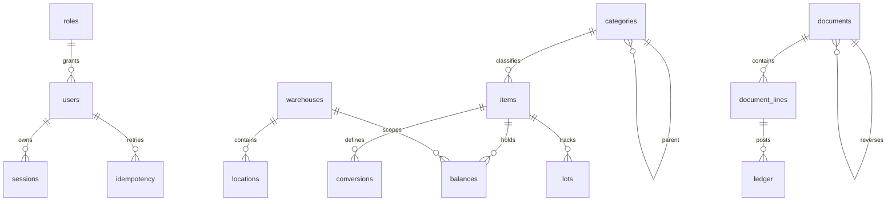

# Architecture and ownership

React + TypeScript + Vite frontend; NestJS modular HTTP API; PostgreSQL central ledger, NUMERIC quantities/costs; private attachments on the inventory volume. Dependencies resolved into a lockfile before building. Android uses Titan's existing bundled WebView/native runtime, avoiding a second Android application/signing identity. Inventory has its own session/native storage and never borrows another section's credentials.

Catalog, authentication, stock workflow, reporting, attachments and administration share one service. No Redis or message broker is required. Durable jobs and idempotency live in PostgreSQL. Local PostgreSQL-compatible test engines are identified separately from a real multi-connection PostgreSQL test.

All write transactions serialize using a transaction-scoped PostgreSQL advisory lock, then re-read current account permissions and affected records. This deliberately conservative first deployment prevents cross-item costing/deadlock races at factory scale. Server revisions are assigned while holding the same commit-order lock, avoiding lost changes due to sequence allocation before commit. Release the lock before returning or performing network/file work.

Stock documents are immutable after posting. Append-only ledger rows drive balances. Explicit inverse documents preserve links and recorded costs. The company-level weighted-average cost is calculated independently from warehouse totals; transfers and custody do not count as consumption. Unpriced stock is flagged as unknown, never silently treated as free.

## Data relationships

The complete schema is versioned in migrations/. Existing factory databases are not a migration source for this service.
